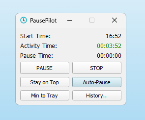

# µTimer

A lightweight desktop timer that tracks your active and pause time and gets
out of your way. Lock your PC, take a break, come back — µTimer keeps the
numbers honest without you having to remember to press anything.



## Features

- **Lock detection.** When you lock the screen, µTimer pauses automatically.
  When you come back, it resumes. No manual click needed.
- **Smart auto-pause.** Short lock-screens (e.g. a quick chat at the door)
  don't count as breaks. Only locks longer than a configurable threshold
  (15 minutes by default) are treated as pauses.
- **Editable history.** Optionally keep a history of past sessions and
  fix-up entries after the fact if you forgot to start or stop the timer.
- **Crash-resilient.** µTimer checkpoints the running session every few
  minutes, so a power cut or unexpected reboot doesn't lose your tracked
  time.
- **Stays out of the way.** Pin-to-top and minimize-to-tray modes; the app
  is small enough to leave in a corner of your screen.

## Install

µTimer is portable: its database, log, and settings files always live next
to the executable. Run it from a folder you can write to (your user profile,
Desktop, a USB stick, etc.) — **not** `Program Files`, `/usr/bin`, or another
admin-protected location, or it will fail to start.

### Windows

Grab the latest pre-built release from the
[Releases page](https://github.com/marifoo/uTimer/releases) and run the
executable. No installer, no admin rights — just drop it in a folder and
start it.

### Linux (build from source)

There is no pre-built binary for Linux, but the app builds and runs on it.
You will need Qt 5 (5.14 or later), a recent GCC, and `qmake`:

```sh
qmake uTimer.pro
make
./uTimer
```

Lock detection on Linux uses D-Bus — systemd-logind, the generic freedesktop
screensaver, GNOME, or KDE, whichever responds first.

## Using it

The main window shows your accumulated **Activity** and **Pause** time for
the current day, plus the time you started.

- **Start / Pause / Stop** — the obvious controls.
- **History** — opens a dialog where you can browse past days and edit
  entries (split a segment, change Activity↔Pause, etc.). Saving may remove
  older entries that span one local midnight or conflict with other saved
  entries; the dialog asks for confirmation before doing so. History closes
  on its own at screen lock, sleep, midnight and shutdown, discarding any
  unsaved edits; a brief tray notice mentions this and may go unseen if you
  are away.
- **Auto-Pause** — toggles whether long locks count as pauses.
- **Pin / Tray** — keeps the window on top, or hides it to the system tray.

µTimer resets at midnight and writes each day's totals to its history.

## Settings

After the first launch, a `user-settings.ini` file appears next to the
binary. The interesting keys:

| Key | Default | What it does |
| --- | --- | --- |
| `autopause_enabled` | `true` | Master switch for auto-pause. |
| `autopause_threshold_minutes` | `15` | Locks shorter than this stay counted as Activity. |
| `history_days_to_keep` | `99` | How many days of history to retain. `0` disables history entirely. |
| `press_start_button_on_app_start` | `true` | Start the timer automatically on launch. |
| `start_minimized_to_tray` | `false` | Launch hidden in the system tray. |
| `start_pinned_to_top` | `false` | Launch with always-on-top enabled. |
| `show_warning_after_9h45min_activity` | `false` | Nudge after a long active stretch. |
| `show_warning_when_not_30min_pause_after_6h_activity` | `false` | Nudge if you haven't taken a real break. |

## For contributors

If you are looking at the source rather than just running the app, see
[`doc/`](doc/README.md) for architecture and design documentation.

GitHub Actions builds the application and runs both `qtest` and `apptest`
on Ubuntu 24.04 for pushes and pull requests. The runners enforce their
existing warning policies under Qt's offscreen platform plugin. To run
the same checks locally on Linux with Qt 5 and its SQLite plugin installed:

```sh
bash scripts/ci-linux.sh
```

The script uses `build/ci/` for build output and builds the production
binary before the app-shell suite that launches it.

A separate CI job checks that the source and header lists in all three
qmake projects match their Visual Studio counterparts. Run it locally with
`python3 scripts/check_vcxproj_parity.py` (or `python` on Windows).

Both test suites also run in a separate Clang 18 build with AddressSanitizer
and UndefinedBehaviorSanitizer. To reproduce it, install `clang-18`,
`libclang-rt-18-dev`, and `llvm-18`, then run:

```sh
bash scripts/ci-linux-sanitizers.sh
```

This uses `build/ci-sanitizers/` and fails on sanitizer reports from the
test runners and their child processes. Leak detection is disabled for
Qt's offscreen plugin allocations; invalid memory access and undefined
behavior checks remain enabled.

Clazy analyzes the production application with its conservative `level0`
checks. Incorrect signal connections, temporary iterators, invalid event
casts, and writes to temporaries fail CI; other findings remain warnings.
On Ubuntu 24.04, install `clazy` and `clang-15`, then run
`bash scripts/ci-linux-clazy.sh`. It uses `build/ci-clazy/` and explicitly
selects Clang 15 to match Ubuntu's Clazy plugin.

The actionlint job checks every GitHub Actions workflow, including embedded
shell commands through ShellCheck. CI downloads actionlint 1.7.12 and
verifies its SHA-256 checksum before running it. With actionlint and
ShellCheck installed, run `actionlint -shellcheck=shellcheck` locally.

## Credits

- Icon by [Icons8](https://icons8.com/icon/63253/clock).
- Built with [Qt 5](https://www.qt.io) (see [`QT-LICENSE.md`](QT-LICENSE.md)).

## License

Licensed under the [MIT License](LICENSE).
