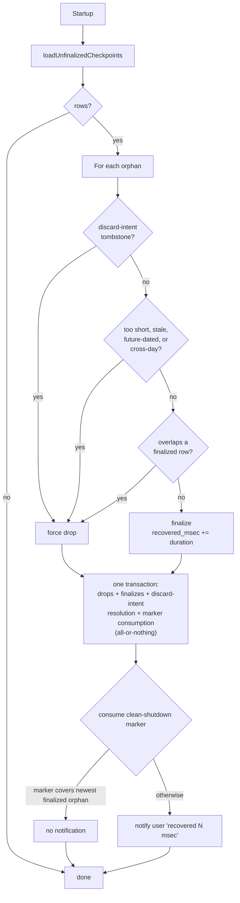

# Persistence

µTimer stores its history in a single SQLite file, `uTimer.sqlite`, that
lives next to the binary. There is no server, no migration tooling, and no
external client — `SqliteSessionStore` is the only thing that reads or
writes it. The schema is checked at startup via `checkSchemaOnStartup()`,
which returns a `SchemaStatus` enum (`Ready`, `Created`, `Outdated`, or
`Inaccessible`). If the result is `Outdated` or `Inaccessible`, the
application refuses to start and asks the user to delete or rename the file.
Only on `Ready` or `Created` does `main.cpp` call `runStartupRecovery()`, which
drives `TimeTracker::initializeFromStore()` (retrying on a modal Retry/Quit
choice if it fails) to consume the clean-shutdown marker and reconcile orphan
checkpoints.

This document is the storage model. For the seam it sits behind, see the
`SessionStore` section in `architecture.md`.

## Tables

The schema is created on first open by `ensureSchema` in
`sqlitesessionstore.cpp`. Two tables:

- **`durations`** — the timeline of completed and in-progress segments. One
  row per segment, identified by a stable `segment_id` (UUID). Columns:
    - `id` (autoincrement primary key)
    - `segment_id` (UUID, `UNIQUE`) — stable across edits and reloads; the
      key TimeTracker uses to update an existing segment instead of inserting a
      new one.
    - `type` (`0` = Activity, `1` = Pause; mirrors `DurationType`).
    - `start_utc`, `end_utc` — segment start and end, stored as ISO-8601
      UTC text (`Qt::ISODateWithMs`). Converted back to local time on
      load; the segment duration is computed from these, not stored.
    - `is_finalized` (`1` = a completed segment, `0` = an in-progress
      checkpoint). Discussed below.
- **`app_settings`** — a key/value table for lifecycle markers. Currently
  the only entry is `last_clean_shutdown`, written exclusively by
  `SqliteSessionStore::markCleanShutdown()` -- the single durable shutdown
  operation `ShutdownCoordinator` invokes once `TimeTracker::drainForShutdown()`
  reports the whole drain (commit and any pending checkpoint-discard intent)
  resolved. `TimeTracker` itself never writes this marker. Consumed
  internally by `recoverStartupCheckpoints()` on the next startup.

Indices: `idx_start_utc` on `durations.start_utc`, a partial index
restricted to `WHERE is_finalized = 1` (used by `hasEntriesForDate` and
orphan overlap probing). Segment ID lookups and upserts use the implicit
unique index created by the `UNIQUE(segment_id)` constraint.

Journal mode is the SQLite default (rollback journal, **not** WAL).
Single-process, single-threaded apps gain nothing from WAL, and rollback
journal keeps the database as a single file — no `-wal`/`-shm` sidecars to
forget when backing up or copying the database elsewhere. `ensureSchema` sets
`PRAGMA synchronous=NORMAL`; `flushToDisc` temporarily promotes to `FULL`
during shutdown so the final write is durably on disk before the process
exits.

## Checkpoints

A checkpoint is a periodic save of the **in-progress** Activity segment.
The cadence is a fixed 5 minutes (`TimeTracker::kCheckpointIntervalMsec`);
there is no setting to change or disable it. `TimeTracker` also attempts an
immediate checkpoint the moment a long lock is detected, and suppresses
further periodic checkpoints while the desktop is locked. This is not a
guaranteed maximum data-loss window: a failed write, disabled History
persistence, or a long locked stretch can all lengthen the actual gap. On
each tick of `TimeTracker::checkpointTimer_`, the engine calls
`SessionStore::saveCheckpoint(...)` with the current `segment_id`. The store
treats this as an upsert keyed by `segment_id`:

- If a row with that `segment_id` already exists, its `end_utc` is updated
  and `is_finalized` is forced to `0` so the row remains "in-progress".
- Otherwise, a new row is inserted with `is_finalized = 0`.

When the segment closes (the user stops, autopause kicks in, or the
day-boundary watcher fires), `TimeTracker` calls `commitSession`, which goes
through `updateDurationsById`. That path writes `is_finalized = 1` for the
same `segment_id`, atomically promoting the checkpoint row to a finalized
entry — no second row is created, no orphan is left behind.

Checkpoints exist for crash recovery: if the process dies between
checkpoint-and-finalize, the next startup can recover most of the
in-progress segment from the unfinalized row. They are deliberately cheap —
`saveCheckpoint` does not create the `.backup` / `.durations.txt` snapshot
that `replaceAll` produces, because at a 5-minute cadence
that would generate hundreds of files per day.

## Orphan reconciliation on startup

After a crash, an "orphan" is a row left with `is_finalized = 0` that no
running process can claim. On startup, `TimeTracker::initializeFromStore()` calls
`SessionStore::recoverStartupCheckpoints(now)`; that single interface method
does all of the reconciliation internally (see `sqlitesessionstore.cpp`
`recoverStartupCheckpoints`), in three steps:

1. **Load** — every row with `is_finalized = 0` is loaded, in id order.
2. **Decide** — for each orphan not already claimed by a durable discard
   intent (see below), decide whether to **finalize** it (treat the last
   known endpoint as the segment's true end and recover the time) or
   **drop** it (delete it without crediting any time). The decision is:
      - Drop if `duration < 1 second` — too short to be a real session.
      - Drop if `endTime` is more than 24 hours old — too stale to trust.
      - Drop if `endTime` is more than `kOrphanFutureSlackMs` (1 minute)
        ahead of `now` — a backward wall-clock jump could otherwise
        resurrect a future-dated checkpoint.
      - Drop if `[startTime, endTime)` crosses a local-day boundary — a
        cross-day row is well-formed but outside the supported contract
        (MUST-FIX4/C3); it is policy-dropped rather than finalized.
      - Otherwise finalize, subject to the overlap check below.
   An orphan whose `segment_id` matches a durable discard-intent tombstone
   (recorded when the engine deliberately discarded that checkpoint, e.g.
   the cross-midnight watchdog — see `discardCheckpoint` in
   `sessionstore.h`) is force-dropped outright, bypassing all of the above,
   and never contributes to `recovered_msec` or to either notification
   (neither the recovered-time one nor the drop one below).
3. **Apply** — malformed-row deletes, policy drops, discard-intent
   resolution, marker consumption, and each remaining orphan's
   finalize-or-delete-on-overlap all run as steps inside **one** transaction
   opened by `recoverStartupCheckpoints` (`sqlitesessionstore.cpp:2249`,
   `reconcileUnfinalizedCheckpoints`); a failure at any step rolls back the
   *entire* disposition, so recovery is all-or-nothing, never partially
   applied. The per-row overlap check itself
   (`finalizeOrOverlapWithinOpenTransaction`) finalizes a row
   (`UPDATE … SET is_finalized = 1`) only if no already-finalized row
   overlaps its `[start_utc, end_utc)` interval; an overlapping orphan is
   not left untouched — it is deleted transactionally as part of the same
   disposition and counted as a policy drop (R08-002), so it cannot recur
   on every future launch.

`TimeTracker` receives only domain facts back via `StartupRecoveryResult`
(`recovered_msec`, `finalized_count`, `policy_dropped_count`,
`discard_dropped_count`, `notify_user`)
— row ids and the finalize/drop mechanics never cross the `SessionStore`
interface.

The **clean-shutdown marker** controls whether the user sees a recovery
notification afterwards. It is written only by `SqliteSessionStore::markCleanShutdown()`,
timestamped via the store's own injected now-provider (not a value the
caller supplies), and only once `ShutdownCoordinator` sees a clean drain --
the same sequence for a running session, an already-stopped one, and
Disabled history. It also participates in the shutdown durability barrier:
`markCleanShutdown()` writes the marker first, then -- only if that write
succeeded -- runs the FULL-durability flush (temporarily promoting
`PRAGMA synchronous`, writing, and restoring `NORMAL`), so the marker's own
commit is covered by that fsync rather than left outside it. A normal
Exit-Anyway termination or a failed OS-forced shutdown never reaches this
operation at all -- no marker, no barrier. On the next startup,
`recoverStartupCheckpoints()` reads and consumes the marker
internally (it is deleted on read once reconciliation succeeds). If the
marker is at or after the *newest* finalized orphan's end time, that means
every recovered orphan was already covered by a clean stop and the user does
not need a "recovered N seconds" notification — only genuinely-crashed
recoveries surface in the UI. Using the oldest orphan instead would wrongly
suppress the notification when an older orphan is covered by the marker but
a newer one is not.

Rows deleted by recovery *policy* (not by an explicit discard) are reported
separately as `policy_dropped_count - discard_dropped_count` and surfaced in
the status bar/tray on the next launch, independently of the clean-marker
logic above.

## History saves (H5/WP5)

A History save is date-scoped, not a whole-table replace:
`HistoryDialog::saveChanges()` builds a per-date diff via
`HistoryEditSession::buildScopedSave()` and persists it through
`TimeTracker::saveHistoryEdit()` / `SqliteSessionStore::saveHistoryDays()`.
Only the dates the user actually edited are touched; every other date, and
every untouched row on an edited date, is left byte-identical. Rows the old
whole-table replace used to drop silently -- a single-boundary cross-midnight
row, a pre-existing cross-type overlap between two untouched rows, a
multi-boundary row, an unfinalized checkpoint row -- are simply never part of
the diff for an unrelated edit, so they now survive a save unmodified instead
of needing a confirmation prompt to avoid losing them.

`HistoryEditSession::buildScopedSave()` computes, for each editable page that
was modified: the changed/new rows to upsert, the ids of rows deleted by a
same-type merge, and whether a merge occurred (`needsMergeConfirmation`) --
`saveChanges()` asks a blocking Yes/No confirmation only in that case,
before persisting. A No leaves the database untouched and the dialog open.
A violation (an edit landing outside its day's span, or creating a new
Activity/Pause overlap with a retained row -- U3) refuses the save with an
"Invalid Entry" message before the store is ever called. An empty diff (e.g.
a toggle back to its original value) is a true no-op, not a failure.

`TimeTracker::saveHistoryEdit()` additionally refuses (`Conflict`) if the
edit was revoked, the local date moved backward, or a day's timezone-derived
span changed since the dialog opened, and refuses (`CallerBug`) if a date in
the diff was not editable at open -- see "Scoped History save" below for the
store's own contract. Any non-`Success` result keeps the user's edits in the
dialog (nothing is written) and shows a critical dialog; the user can retry
or cancel.

`SessionStore::replaceAll()` and its safety-backup step still exist in
production code (removed only in a later package, C11), but nothing in
`HistoryDialog`'s save path calls them any more.

### Scoped History save (H5/WP2)

`SqliteSessionStore::saveHistoryDays(openSnapshot, days)` is the write path
`HistoryDialog` uses (H5/WP5) -- exercised directly by
`test_database.cpp`/`test_contract_matrix.cpp`, and end-to-end through
`HistoryDialog` by `test_historydialog.cpp`/`test_history_commit.cpp`.

`openSnapshot` is the caller's own `loadHistoryRows()` read, taken once when
History was opened. `days` carries one `HistoryDayChange` per edited local
date: the date's UTC span, the ids of rows deleted outright, and the changed/
new rows to upsert. Only rows named in `days` are ever touched; every other
row, on every date, is left byte-identical, and no unfinalized row is ever
touched.

Everything below runs inside **one transaction covering every day** in
`days`:

1. **CallerBug** input-shape checks run first, before any mutation and before
   the Disabled check (the same precedence `commitSession`/`replaceAll`/
   `saveCheckpoint`/`discardCheckpoint` already use): unique dates, valid
   non-empty spans, ids unique across every day's deletes and upserts
   combined (which also catches an id both deleted and upserted), every
   deleted id and every upsert id present in `openSnapshot` must be editable
   for its day (finalized, well-formed, interval fully inside the day's
   span), and every upsert must pass `DayValidity::validatePayload()` and lie
   inside its span.
2. `Disabled` if history storage is off; `TransientError` if the connection
   or the transaction cannot be opened.
3. **Stale check, per day.** The day is re-read with the text predicate
   `start_utc < :dayEnd AND end_utc > :dayStart` (both rendered as canonical
   UTC-ISO text via the same `toUtcIso()` every write uses), and compared
   against the `openSnapshot` rows matching the identical text predicate in
   C++, as a multiset of the five raw columns. Any difference rolls back the
   whole transaction and returns `Conflict`. This assumes every row uTimer
   writes stores canonical UTC-ISO text, so text order equals time order; a
   non-canonical (hand-edited) row is judged by the same predicate on both
   sides, so a change to it is still detected -- the only accepted gap is
   such a row whose actual time overlaps the day but whose text does not,
   which uTimer itself never produces.
4. **New-conflict check, per day.** Retained rows are the re-read,
   well-formed rows minus this day's deleted/upserted ids. Any upsert
   overlapping a retained row of the other type rolls back and returns
   `CallerBug` (the overlap rule the History user decisions call U3), via the
   shared `DayValidity::hasNewCrossTypeOverlap()` helper in `dayvalidity.h`.
5. **Apply**, once every day has passed its checks: each delete and each
   update (an upsert id already present in `openSnapshot`) is matched by
   `segment_id AND is_finalized = 1` and must affect exactly one row --
   otherwise rollback and `Conflict`. Every other upsert id is inserted; a
   SQL failure there, including a UNIQUE clash, rolls back and returns
   `TransientError`.
6. **Commit** through the same `commitOrRollback()` every write boundary
   uses (a failed rollback closes the connection), then, in debug builds,
   `checkSegmentIdUniqueness()`.

No backup and no `*.durations.txt` export -- this path never creates either.

### Revoked edits

When the engine revokes History's edit (at lock, sleep, midnight or shutdown),
the dialog is flagged (`editRevoked_`) immediately. A revoke is never followed
by a new save: `saveChanges()` checks `editRevoked_` right after the
`result()` guard, and again immediately before calling `saveHistoryEdit()`,
since the merge-confirmation prompt runs a nested event loop that can revoke
after the early check. `TimeTracker::saveHistoryEdit()` itself also refuses
(`Conflict`) once the edit is revoked (`dialog_open_` is false), as a second,
engine-side enforcement of the same rule. Because `saveHistoryDays()` is one
transaction with no nested event loop, a save always lands whole or not at
all -- there is no window where a revoke can land after the write starts but
before it commits.

## What is inside the `SessionStore` seam — and what is not

Everything in this document — the SQL, the transactions, the
`is_finalized` flag, the orphan-id bookkeeping, the backup files, retention
cleanup, schema migrations — lives **inside** `SqliteSessionStore`. None of
it crosses the interface defined in `sessionstore.h`. `TimeTracker` calls
`commitSession`, `replaceAll`, `loadDurations`, `hasEntriesForDate`,
`saveCheckpoint`, `discardCheckpoint`, `recoverStartupCheckpoints`, and
`checkSchemaOnStartup`; `flushToDisc` and `markCleanShutdown` (the sole
owner of writing the clean-shutdown marker) are called only by
`ShutdownCoordinator` as part of the shutdown sequence, not by `TimeTracker`
itself. `loadHistoryRows` is a separate read-only seam: it returns every row
exactly as stored (finalized, unfinalized, multi-boundary, and malformed
alike), never deletes or repairs anything, and is used by History's
date-scoped editor rather than by `TimeTracker`. `saveHistoryDays` (H5/WP2,
see "Scoped History save" above) is the date-scoped write counterpart to
`loadHistoryRows`; `HistoryDialog` saves through it exclusively (H5/WP5).
That is what makes `FakeSessionStore` in `qtest/` viable: it can
re-implement the interface in pure C++ data structures and the engine code
is none the wiser.
