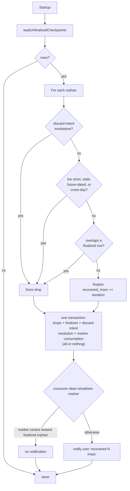

# Persistence

µTimer stores its history in a single SQLite file, `uTimer.sqlite`, that
lives next to the binary. There is no server, no migration tooling, and no
external client — `SqliteSessionStore` is the only thing that reads or
writes it. The schema is checked at startup via `checkSchemaOnStartup()`,
which returns a `SchemaStatus` enum (`Ready`, `Created`, `Outdated`, or
`Inaccessible`). If the result is `Outdated` or `Inaccessible`, the
application refuses to start and asks the user to delete or rename the file.
Only on `Ready` or `Created` does `main.cpp` call `runStartupRecovery()`, which
drives `TimeTracker::initializeFromStore()` (retrying on a modal Retry/Quit
choice if it fails) to consume the clean-shutdown marker and reconcile orphan
checkpoints.

This document is the storage model. For the seam it sits behind, see the
`SessionStore` section in `architecture.md`.

## Tables

The schema is created on first open by `ensureSchema` in
`sqlitesessionstore.cpp`. Two tables:

- **`durations`** — the timeline of completed and in-progress segments. One
  row per segment, identified by a stable `segment_id` (UUID). Columns:
    - `id` (autoincrement primary key)
    - `segment_id` (UUID, `UNIQUE`) — stable across edits and reloads; the
      key TimeTracker uses to update an existing segment instead of inserting a
      new one.
    - `type` (`0` = Activity, `1` = Pause; mirrors `DurationType`).
    - `start_utc`, `end_utc` — segment start and end, stored as ISO-8601
      UTC text (`Qt::ISODateWithMs`). Converted back to local time on
      load; the segment duration is computed from these, not stored.
    - `is_finalized` (`1` = a completed segment, `0` = an in-progress
      checkpoint). Discussed below.
- **`app_settings`** — a key/value table for lifecycle markers. Currently
  the only entry is `last_clean_shutdown`, written exclusively by
  `SqliteSessionStore::markCleanShutdown()` -- the single durable shutdown
  operation `ShutdownCoordinator` invokes once `TimeTracker::drainForShutdown()`
  reports the whole drain (commit and any pending checkpoint-discard intent)
  resolved. `TimeTracker` itself never writes this marker. Consumed
  internally by `recoverStartupCheckpoints()` on the next startup.

Indices: `idx_start_utc` on `durations.start_utc`, a partial index
restricted to `WHERE is_finalized = 1` (used by `hasEntriesForDate` and
orphan overlap probing). Segment ID lookups and upserts use the implicit
unique index created by the `UNIQUE(segment_id)` constraint.

Journal mode is the SQLite default (rollback journal, **not** WAL).
Single-process, single-threaded apps gain nothing from WAL, and rollback
journal keeps the database as a single file — no `-wal`/`-shm` sidecars to
forget when backing up or copying the database elsewhere. `ensureSchema` sets
`PRAGMA synchronous=NORMAL`; `flushToDisc` temporarily promotes to `FULL`
during shutdown so the final write is durably on disk before the process
exits.

## Checkpoints

A checkpoint is a periodic save of the **in-progress** Activity segment.
The cadence is a fixed 5 minutes (`TimeTracker::kCheckpointIntervalMsec`);
there is no setting to change or disable it. `TimeTracker` also attempts an
immediate checkpoint the moment a long lock is detected, and suppresses
further periodic checkpoints while the desktop is locked. This is not a
guaranteed maximum data-loss window: a failed write, disabled History
persistence, or a long locked stretch can all lengthen the actual gap. On
each tick of `TimeTracker::checkpointTimer_`, the engine calls
`SessionStore::saveCheckpoint(...)` with the current `segment_id`. The store
treats this as an upsert keyed by `segment_id`:

- If a row with that `segment_id` already exists, its `end_utc` is updated
  and `is_finalized` is forced to `0` so the row remains "in-progress".
- Otherwise, a new row is inserted with `is_finalized = 0`.

When the segment closes (the user stops, autopause kicks in, or the
day-boundary watcher fires), `TimeTracker` calls `commitSession`, which goes
through `updateDurationsById`. That path writes `is_finalized = 1` for the
same `segment_id`, atomically promoting the checkpoint row to a finalized
entry — no second row is created, no orphan is left behind.

Checkpoints exist for crash recovery: if the process dies between
checkpoint-and-finalize, the next startup can recover most of the
in-progress segment from the unfinalized row. They are deliberately cheap —
`saveCheckpoint` does not create the `.backup` / `.durations.txt` snapshot
that `replaceAll` produces, because at a 5-minute cadence
that would generate hundreds of files per day.

## Orphan reconciliation on startup

After a crash, an "orphan" is a row left with `is_finalized = 0` that no
running process can claim. On startup, `TimeTracker::initializeFromStore()` calls
`SessionStore::recoverStartupCheckpoints(now)`; that single interface method
does all of the reconciliation internally (see `sqlitesessionstore.cpp`
`recoverStartupCheckpoints`), in three steps:

1. **Load** — every row with `is_finalized = 0` is loaded, in id order.
2. **Decide** — for each orphan not already claimed by a durable discard
   intent (see below), decide whether to **finalize** it (treat the last
   known endpoint as the segment's true end and recover the time) or
   **drop** it (delete it without crediting any time). The decision is:
      - Drop if `duration < 1 second` — too short to be a real session.
      - Drop if `endTime` is more than 24 hours old — too stale to trust.
      - Drop if `endTime` is more than `kOrphanFutureSlackMs` (1 minute)
        ahead of `now` — a backward wall-clock jump could otherwise
        resurrect a future-dated checkpoint.
      - Drop if `[startTime, endTime)` crosses a local-day boundary — a
        cross-day row is well-formed but outside the supported contract
        (MUST-FIX4/C3); it is policy-dropped rather than finalized.
      - Otherwise finalize, subject to the overlap check below.
   An orphan whose `segment_id` matches a durable discard-intent tombstone
   (recorded when the engine deliberately discarded that checkpoint, e.g.
   the cross-midnight watchdog — see `discardCheckpoint` in
   `sessionstore.h`) is force-dropped outright, bypassing all of the above,
   and never contributes to `recovered_msec` or to either notification
   (neither the recovered-time one nor the drop one below).
3. **Apply** — malformed-row deletes, policy drops, discard-intent
   resolution, marker consumption, and each remaining orphan's
   finalize-or-delete-on-overlap all run as steps inside **one** transaction
   opened by `recoverStartupCheckpoints` (`sqlitesessionstore.cpp:2249`,
   `reconcileUnfinalizedCheckpoints`); a failure at any step rolls back the
   *entire* disposition, so recovery is all-or-nothing, never partially
   applied. The per-row overlap check itself
   (`finalizeOrOverlapWithinOpenTransaction`) finalizes a row
   (`UPDATE … SET is_finalized = 1`) only if no already-finalized row
   overlaps its `[start_utc, end_utc)` interval; an overlapping orphan is
   not left untouched — it is deleted transactionally as part of the same
   disposition and counted as a policy drop (R08-002), so it cannot recur
   on every future launch.

`TimeTracker` receives only domain facts back via `StartupRecoveryResult`
(`recovered_msec`, `finalized_count`, `policy_dropped_count`,
`discard_dropped_count`, `notify_user`)
— row ids and the finalize/drop mechanics never cross the `SessionStore`
interface.

The **clean-shutdown marker** controls whether the user sees a recovery
notification afterwards. It is written only by `SqliteSessionStore::markCleanShutdown()`,
timestamped via the store's own injected now-provider (not a value the
caller supplies), and only once `ShutdownCoordinator` sees a clean drain --
the same sequence for a running session, an already-stopped one, and
Disabled history. It also participates in the shutdown durability barrier:
`markCleanShutdown()` writes the marker first, then -- only if that write
succeeded -- runs the FULL-durability flush (temporarily promoting
`PRAGMA synchronous`, writing, and restoring `NORMAL`), so the marker's own
commit is covered by that fsync rather than left outside it. A normal
Exit-Anyway termination or a failed OS-forced shutdown never reaches this
operation at all -- no marker, no barrier. On the next startup,
`recoverStartupCheckpoints()` reads and consumes the marker
internally (it is deleted on read once reconciliation succeeds). If the
marker is at or after the *newest* finalized orphan's end time, that means
every recovered orphan was already covered by a clean stop and the user does
not need a "recovered N seconds" notification — only genuinely-crashed
recoveries surface in the UI. Using the oldest orphan instead would wrongly
suppress the notification when an older orphan is covered by the marker but
a newer one is not.

Rows deleted by recovery *policy* (not by an explicit discard) are reported
separately as `policy_dropped_count - discard_dropped_count` and surfaced in
the status bar/tray on the next launch, independently of the clean-marker
logic above.

## History saves

A History save is a whole-table replace: all durations in the
`durations` table are deleted and re-inserted based on the edited
timeline. Consequently, editing one row on one day rewrites every
day's entries.

When `HistoryDialog::saveChanges()` calls `replaceAll()`, it may
remove rows the user never touched:

1. **Cross-midnight rows** (counted): A single-boundary row that
   crosses one local calendar boundary is displayed read-only in
   History (since it spans more than one local date) but is
   deliberately never added to `pendingTimelines_`. Therefore,
   `buildSavePayload()` builds the save payload from
   `pendingTimelines_[i].completed()` and the row is simply absent
   from the payload — it is not discarded, but was never included.

2. **Pre-existing overlaps** (counted): A persisted, unedited
   Activity/Pause overlap between two already-saved rows (or between
   a saved row and an unedited ongoing row) is resolved by a
   `(startTime, segment_id)` tie-break. When the overlap is
   completed-vs-completed, both rows compete in the tie-break and
   the loser is dropped. When one row is ongoing, the ongoing row
   is never dropped — only a conflicting completed row can lose.
   This is reported in the payload as `preExistingOverlapDrops`.

Before a destructive replace, `saveChanges()` computes both counts
and asks a blocking Yes/No confirmation before any database write:
"{count} entries spanning midnight will be removed. {count}
pre-existing overlapping entries will be removed. Continue saving?"
The prompt appears only if either count is positive and the save
will actually call `replaceAll()` (i.e., the history or session
timeline is non-empty). A No leaves the database untouched and the
dialog open; the user can retry or cancel editing.

The dialog does **not** count or announce rows spanning more than
one local midnight — those are discarded on load and never reach
the display or the editor.

Additionally, an unfinalized row (checkpoint with `is_finalized = 0`)
that was not loaded by the model (e.g., because `loadDurations()`
filters to `is_finalized = 1`) is also erased by the whole-table
replace. This fourth deletion path is not covered by the confirmation
prompt; its production reachability is outside the scope of this
feature.

Before the replace, a safety backup is attempted
(`SqliteSessionStore::replaceAll()`, before the write), but it may
fail due to low disk space or a copy error; in that case, the user
is warned after the save has been committed. Nothing in the UI or
documentation promises that an overwritten row is recoverable.

This differs from orphan reconciliation on startup
(`recoverStartupCheckpoints()`), which applies a policy-drop decision
and one-time transaction to decide whether orphans are finalized or
removed. History saves replace the table unconditionally after
confirmation.

### Revoked edits

When the engine revokes History's edit (at lock, sleep, midnight or shutdown),
the dialog is flagged immediately. A revoke is never followed by a new save.
If a save is in-flight when the revoke lands, the outcome depends on timing:
if the revoke interrupts Steps 1–3 (model construction, conflict checking, user
prompts), the save writes nothing and the table remains untouched. If the save
already committed before the revoke (e.g. the revoke lands during the M2 warning
shown after Step 4), the committed changes stay. Steps 4 and 5 run without an
event loop, so a save lands whole or not at all.

## What is inside the `SessionStore` seam — and what is not

Everything in this document — the SQL, the transactions, the
`is_finalized` flag, the orphan-id bookkeeping, the backup files, retention
cleanup, schema migrations — lives **inside** `SqliteSessionStore`. None of
it crosses the interface defined in `sessionstore.h`. `TimeTracker` calls
`commitSession`, `replaceAll`, `loadDurations`, `hasEntriesForDate`,
`saveCheckpoint`, `discardCheckpoint`, `recoverStartupCheckpoints`, and
`checkSchemaOnStartup`; `flushToDisc` and `markCleanShutdown` (the sole
owner of writing the clean-shutdown marker) are called only by
`ShutdownCoordinator` as part of the shutdown sequence, not by `TimeTracker`
itself. That is what makes `FakeSessionStore` in `qtest/` viable: it can
re-implement the interface in pure C++ data structures and the engine code
is none the wiser.
