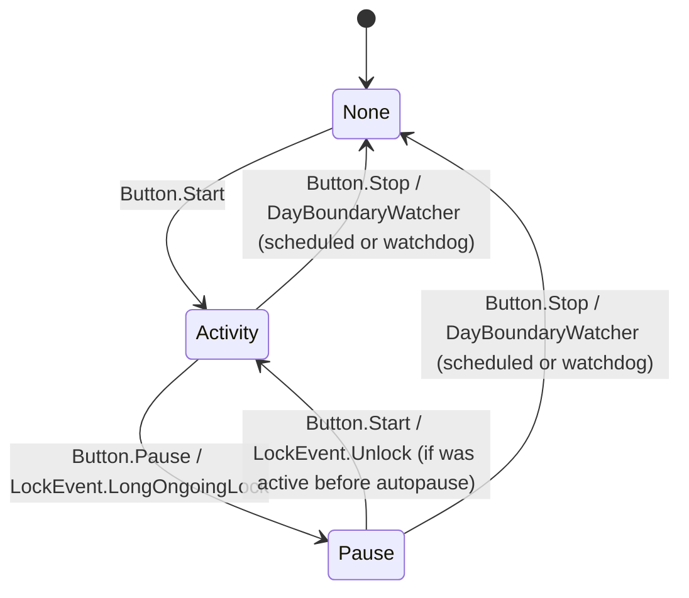
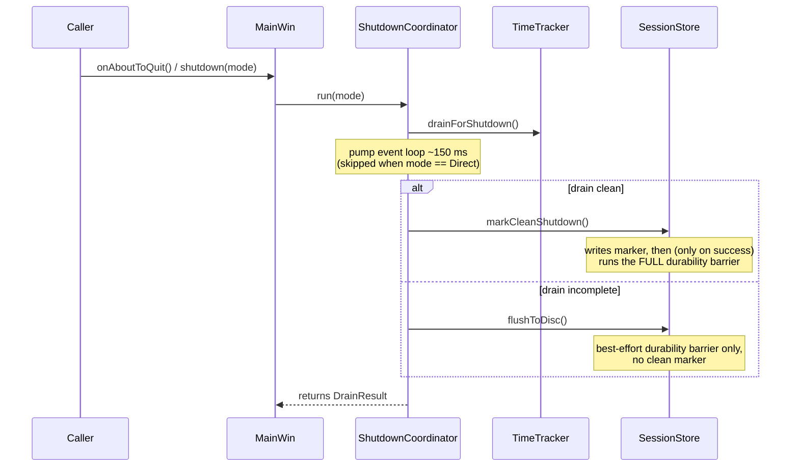

# Runtime behaviour

This document covers what happens *while µTimer is running*: the state
machine, the heartbeat that ticks it, how cross-midnight cases are handled,
and how shutdown is orchestrated. For *what the components are*, see
`architecture.md`; for *what is stored on disk*, see `persistence.md`.

## TimeTracker state machine

`TimeTracker` runs three modes: `None` (stopped), `Activity`, and `Pause`.
Transitions are driven by user buttons, lock events from
`LockStateWatcher`, and the `DayBoundaryWatcher` at the day boundary.

`TimeTracker` carries the reason for a transition, not just the transition
itself, so the GUI can react without keeping its own state:

- `TimeTracker::transitioned(Transition)` — the one cause-carrying event for
  every real mode change, button/lock/midnight/edit/shutdown-driven alike.
  `Transition` holds `from`, `to`, and a `TransitionCause` (`ButtonStart`,
  `ButtonPause`, `ButtonStop`, `LockAutopause`, `LockResume`,
  `MidnightScheduled`, `MidnightWatchdog`, `Shutdown`, `EditApplied`,
  `FatalStoreError`). `ContentWidget::onTransitioned` reduces it to a GUI
  update; there is no separate per-cause signal for each transition kind
  the way there used to be.
- `TimeTracker::stopped(StopReason)` — kept as a separate terminal-only
  event (`ButtonStop`, `MidnightScheduled`, `MidnightWatchdog`, `Shutdown`,
  `EditApplied`, `FatalStoreError`), derived from the same emission point as
  `transitioned()`, for observers that only care "did tracking stop, and
  why" (today just `HealthMonitor::reset`).

`Lock` (without "Long") does **not** transition the engine on its own; it
suspends checkpoints (so checkpoints do not move while the user is away) and
arms `LockStateWatcher`'s internal lock timer. Only `LongOngoingLock`
crosses the threshold and triggers autopause inside `TimeTracker`.

## The 100 ms heartbeat

A single `QTimer` in `main.cpp` ticks every 100 ms. Three slots are wired to
its `timeout()` signal:

1. **`MainWin::onTick`** — refreshes the time labels and tooltips by reading
   the current snapshot from `TimeTracker`.
2. **`TimeTracker::onTick`** — calls `DayBoundaryWatcher::tick` (the cross-midnight
   watchdog). This is the *only* path that runs `TimeTracker` code from the
   heartbeat; mode transitions are still driven exclusively by buttons and
   lock events.
3. **`LockStateWatcher::update`** — polls the OS lock state, pushes the
   boolean through the 5-tick debounce buffer, and emits at most one
   `desktopLockEvent` per tick.

Why 100 ms? It is fast enough to keep the time labels visibly fluid, fast
enough that the lock debounce window is well under a second, and slow enough
not to register on a CPU profile.

## `SessionState`

`TimeTracker` groups its mutable per-session data into the `SessionState` struct
(see `timetracker.h`). The rationale is documented in the header comment and is
worth quoting rather than restating: previously these fields were scattered
as raw members, making it easy for code paths to mutate them as side-effects.
Grouping them into a struct with explicit, named transition methods
(`beginNewSegment`, `clearSegment`, `updateSegmentStartTime`,
`resetForNewSession`, `adoptOngoingSegment`) ensures every mutation is
logged at debug level and is therefore traceable in the log output.

The struct is owned by `TimeTracker` and is not exposed to callers — `Timeline`
is the read-only view that `MainWin` and `HistoryDialog` consume via
`TimeTracker::snapshot()`.

## Cross-midnight handling

A session must never contain a segment that spans two dates: the persistence
layer stores `start_utc`/`end_utc` timestamps (see `persistence.md`), and
downstream UI groups rows by the local date those timestamps convert to, not
by a stored date column. `TimeTracker` enforces this with a single dedicated
subsystem:
`DayBoundaryWatcher`. It uses two mechanisms together:

1. **Scheduled stop** — a single-shot `QTimer` armed for **23:59:59.500**
   today (`armScheduledStop`). When it fires, the engine stops with
   `StopReason::MidnightScheduled`.
2. **Watchdog** — `DayBoundaryWatcher::tick` runs on every 100 ms heartbeat
   and checks whether the ongoing segment has crossed midnight (which can
   happen if the machine slept past the scheduled time). If so, it forces
   the engine into `None` and discards the in-flight segment, emitting
   `StopReason::MidnightWatchdog`.

A last-line defence in `TimeTracker::addDuration` silently discards any segment
whose `startTime.date() != endTime.date()`. In normal operation the two
mechanisms above make that branch unreachable; it exists so that a logic
bug elsewhere cannot poison the in-memory session or the database.

`MainWin` has **no** midnight logic. It reacts to `stopped(StopReason)` like
any other stop.

### History force-close at midnight, lock, sleep, and shutdown

When `HistoryDialog` is open and any of the following events occurs, the engine
revokes History's edit, closes the dialog, and discards any unsaved changes:

- **Midnight boundary:** scheduled stop (23:59:59.500), watchdog tick detecting
  a crossed midnight boundary, or the date moving forward (`now.date() > date_
  when_edit_began`).
- **Lock events:** any lock-watcher event (Lock, LongOngoingLock, or Unlock).
- **Sleep:** a lock event is usually what closes History during sleep; if the
  machine sleeps across midnight without a lock, the midnight watchdog closes
  it.
- **Shutdown/logout/SIGTERM/end-session:** the shutdown sequence revokes
  History before stopping the live segment.

The revoke mechanism runs **before** the engine makes any state change for the
event. `TimeTracker::revokeExclusiveEdit()` emits `exclusiveEditRevoked()`,
which synchronously sets a flag on `HistoryDialog`, then queues `closeRevoked()`
to close any open child dialogs and menus, then closes History itself with
`reject()`. `HistoryDialog::saveChanges()` checks the flag and refuses all
database writes, so no partial save or retry can succeed.

A tray notification (`userWarning` signal) is sent whenever History closes:
`"History was closed (screen lock, sleep, midnight, shutdown or a database error); any unsaved
changes were discarded."` This notification appears in the tray balloon and
status bar for ~10 seconds and may go unseen if the user is away (e.g. at
lock time or overnight).

### Sleep outcomes

Without History open (or after History closes), the night-time behaviour is:

- **Lock before sleep, with auto-pause matured:** Activity up to the lock and
  Pause up to the auto-pause threshold are committed. After an overnight resume,
  the watchdog discards only the ongoing Pause. The evening's Activity is kept.
- **Lock before sleep, without auto-pause matured:** the segment is still
  Activity. The overnight tick discards the **whole segment**, including the
  evening's Activity. This matches the watchdog policy and is not a History
  effect.
- **Sleep across midnight without a lock:** the tick revokes any open History
  and discards the segment, same as without a dialog.
- **Same-day resume:** the Lock and LongOngoingLock are handled normally.
- **Sleep same day without a lock:** History stays open, nothing is deferred
  and the DB is untouched. Slept time counts as Activity with or without
  History; this is a known suspend finding and out of scope.

## Shutdown flow

The shutdown sequence is owned by `ShutdownCoordinator`. `MainWin::shutdown(ShutdownMode)`
is the single entry point into it, reached from three places:

- Normal close (`MainWin::closeEvent`, tray-menu Quit) calls
  `shutdown(ShutdownMode::DrainEvents)` directly; `QCoreApplication::aboutToQuit`
  → `MainWin::onAboutToQuit` calls it again once the last window closes. Both
  reach the same idempotent `ShutdownCoordinator::run`, so a normal quit
  always runs the sequence twice, harmlessly.
- Windows session end (`WM_QUERYENDSESSION` / `WM_ENDSESSION` handled in
  `MainWin::nativeEvent`) → `shutdown(ShutdownMode::Direct)`, which skips the
  event-loop pump since the OS event loop is restricted during this path.
  A `WM_ENDSESSION` with `wParam == 0` means the shutdown was *cancelled*:
  `MainWin::nativeEvent` calls `ShutdownCoordinator::cancelShutdown()`
  instead, which clears the `run()` guard and `TimeTracker`'s shutdown-latch
  so the application returns to an ordinary, fully usable stopped state and
  the next real shutdown (or History save) runs the full path again.
- Linux signal (`SIGTERM` / `SIGINT` / `SIGHUP`) → `MainWin::onAboutToQuit`
  via the signal-handling pattern described below.

**History during shutdown:** If `HistoryDialog` is open, `TimeTracker::shutdown()`
revokes the edit immediately after acquiring the engine lock and before the
terminal flag or stop. The dialog is flagged to close, its edits are discarded,
and the engine then proceeds with the normal shutdown sequence (commit the live
segment, drain pending work, etc.) as if History were not open.

`ShutdownCoordinator::run` is idempotent (`shutdown_completed_` guard) so
multiple triggers fire it exactly once (until `cancelShutdown()` re-arms it).
On a `DrainEvents` failure `MainWin::shutdown` shows a modal Retry / Exit
Anyway choice; each Retry calls `ShutdownCoordinator::retryDrain()` for one
new attempt. The clean-shutdown marker is written
by exactly one owner, `SqliteSessionStore::markCleanShutdown()`, and only
when `TimeTracker::drainForShutdown()` reports the whole drain (commit and
any pending checkpoint-discard intent) resolved — this is what lets the next
startup distinguish "we left checkpoints behind because we crashed" from "we
left checkpoints behind because we shut down before flushing"; see
`persistence.md` for how that distinction is used.

### Linux: Unix signals via socketpair

Signal handlers may only call async-signal-safe functions, so the handler in
`main.cpp` does the bare minimum: it writes the signal number to one end of
a `socketpair`. A `QSocketNotifier` watches the other end and, inside the
event loop, calls `UnixSignalBridge::drainPending()` — which coalesces
however many signals arrived between two event-loop turns into one shutdown
invocation — then calls `MainWin::onAboutToQuit` followed by
`QCoreApplication::quit`. This is the standard Qt pattern for
signal-to-event-loop bridging; it lives in `main.cpp` because it has to be
installed *before* `QApplication` is constructed. On Windows the same role
is filled by the `WM_QUERYENDSESSION` / `WM_ENDSESSION` path in
`MainWin::nativeEvent`, which calls `shutdown(ShutdownMode::Direct)` directly.

This is the one place where the platform difference matters for runtime
behaviour — the rest of the code is portable.
